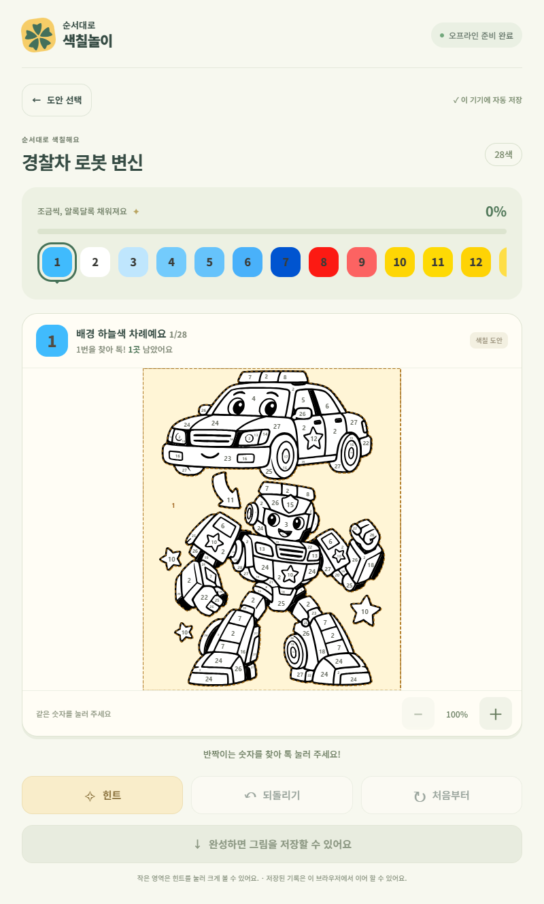
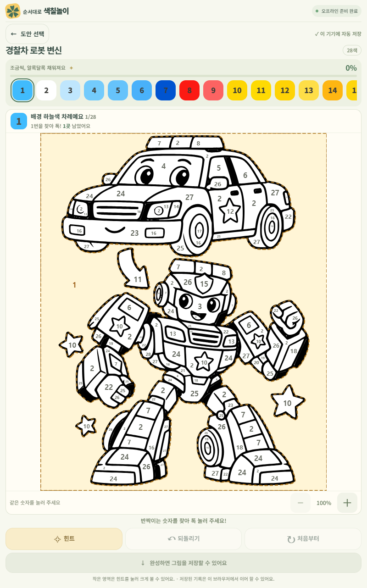
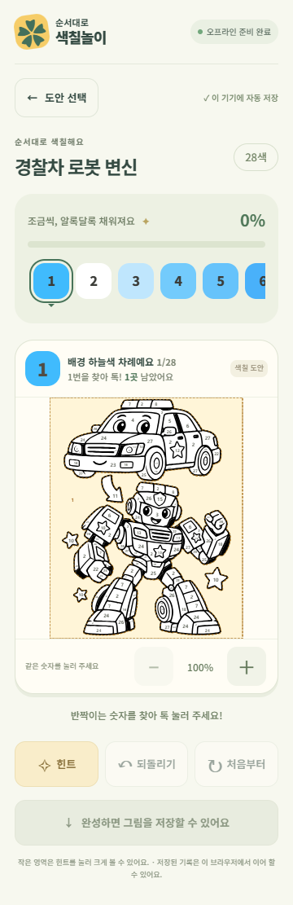
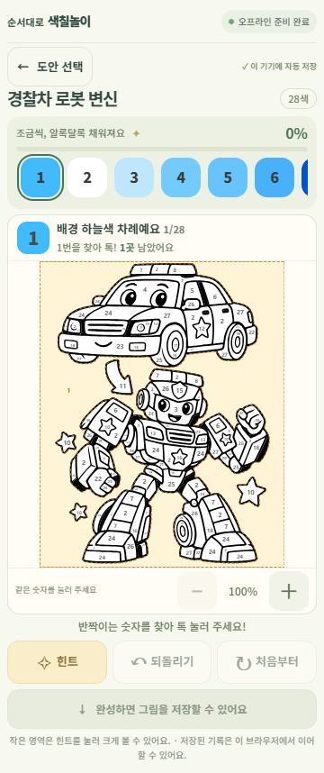
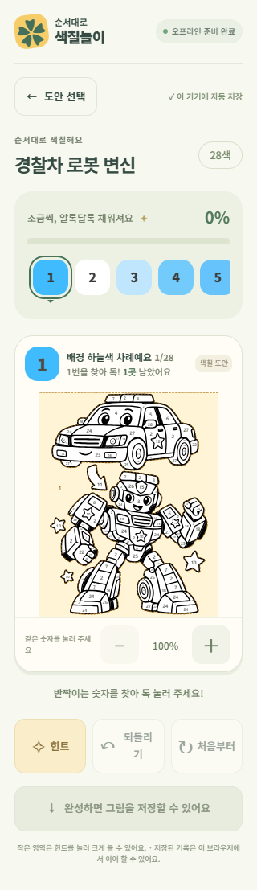
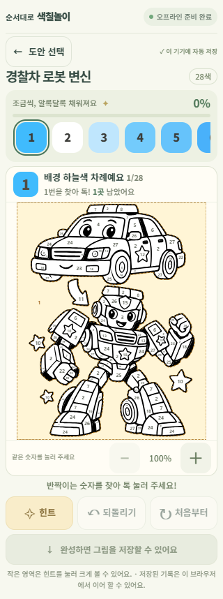

# 세로 화면 레이아웃 비교

기준 코드: `f6a09b374ffd9092d4d4d2086a8526a4ffbe469f` (main).
경찰차 로봇을 처음 연 상태에서 같은 브라우저, 같은 화면 크기로 비교했습니다.
기존 스크린샷 재사용이 아니라 기준 코드의 CSS와 수정 CSS를 각각 적용한 촬영입니다.

| 화면 | 기존 도안 크기 | 수정 도안 크기 | 길이 증가 |
| --- | --- | --- | --- |
| 태블릿 800×1280 | 379×474 | 625×780 | 약 65% |
| 모바일 360×800 | 237×296 | 272×340 | 약 15% |
| 작은 모바일 320×568 | 224×280 | 272×340 | 약 21% |

태블릿 도안 면적은 약 2.7배입니다. SVG 전체 비율과 viewBox를 유지합니다.
화면 높이에 맞춰 도안 크기를 정하되, 작은 화면에서는 최소 높이 340px을 확보하고
아래 도구는 페이지를 세로로 스크롤해 사용합니다. 확대 시에는 기존처럼 도안 내부를 이동합니다.
모든 조작 버튼은 최소 44×44px이며, 주요 힌트/되돌리기/초기화는 높이 48px입니다.
팔레트는 기존의 가로 스크롤과 현재 색상 자동 이동을 유지합니다.

## 태블릿: 수정 전 / 수정 후

## 모바일 360×800: 수정 전 / 수정 후

## 작은 모바일 320×568: 수정 전 / 수정 후

## 검증

- TypeScript 검사와 배포용 빌드 통과, 기본 검사 32개 통과.
- 브라우저 검사 총 22개 항목 통과(초기 20개 + 보완 후 재검사).
- 세 화면에서 전체 도안이 기본 배율에 잘림 없이 들어가는지, 비율, 가로 넘침,
  버튼 최소 크기, 확대/원래 크기 복귀를 검사하고 위 비교 이미지를 생성합니다.
- 무지개/경찰차 도안 터치 판정, 순서, 자동 전환, 힌트, 되돌리기, 저장 복원,
  확인 후 초기화, 완성, PNG 파일 및 픽셀, 오프라인 새로고침/이어 칠하기 검사 통과.
- 초기 무지개 완성 검사는 브라우저 종료 과정이 기본 30초 제한을 넘었습니다.
  해당 검사를 단독으로 120초 제한으로 재실행하여 통과했습니다.
- Galaxy Tab 실물 검증은 하지 않았으며 데스크톱 Chrome의 터치 화면 모의 검사입니다.

다시 검사: `npm run build`, `npm test`, `npm run test:e2e -- --timeout 120000 --workers 1`.
비교 검사에는 Git 이력이 필요합니다(얕은 checkout에서는 기준 커밋도 가져와야 합니다).
