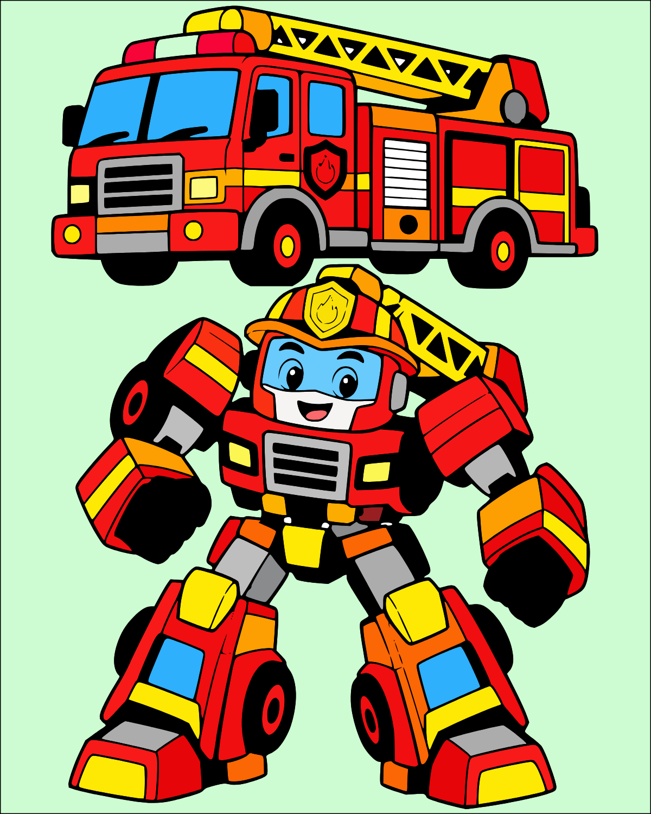
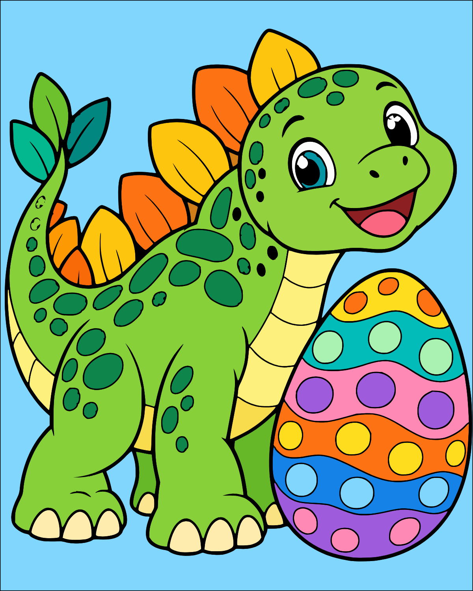
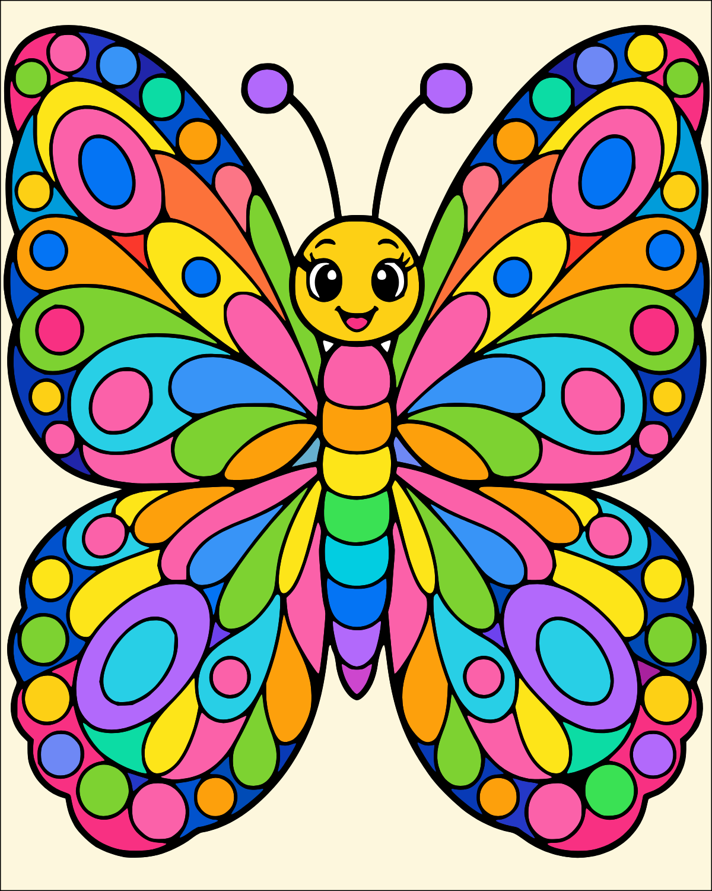
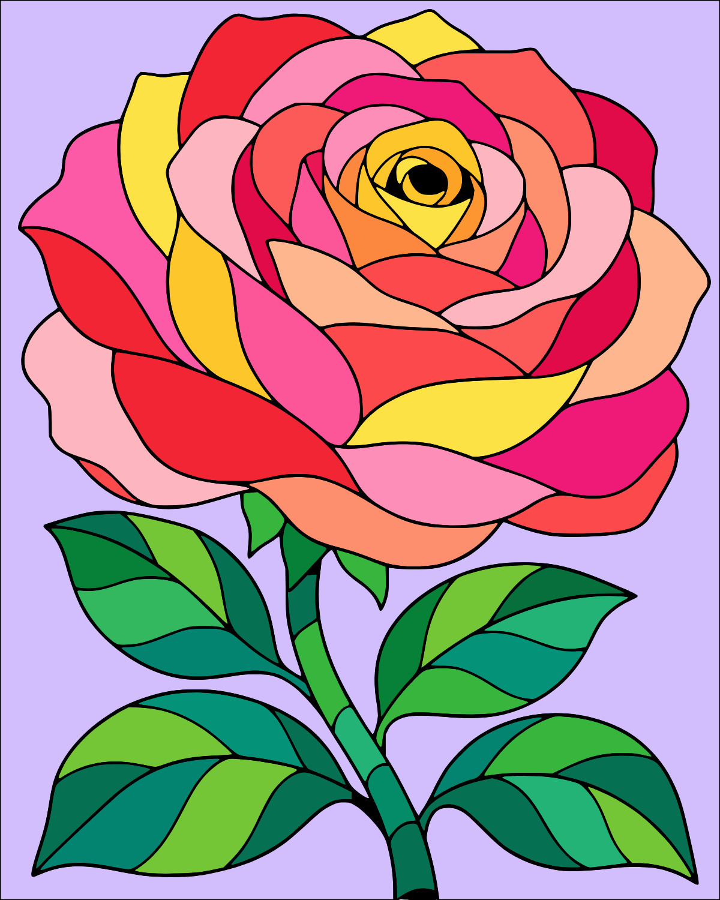

# 완성 도안 5개

기존 경찰차 로봇 도안은 원본·영역·28색·revision·저장 키까지 그대로 유지했습니다.
무지개 도안의 현재 이미지·데이터·제작 도구와 앱 노출을 삭제하고 새 도안 4개를 추가했습니다.
새 버전을 열면 무지개 도안의 과거 진행 기록만 정리합니다. 다른 도안 기록은 유지합니다.

아래 완성 그림은 생성 원본이 아닌 **실제 앱의 SVG에서 저장한 PNG**입니다.

| 소방차 로봇 변신 | 공룡과 알 |
| --- | --- |
|  |  |
| 28단계 · 143곳 | 28단계 · 99곳 |

| 알록달록 나비 | 장미꽃 |
| --- | --- |
|  |  |
| 28단계 · 161곳 | 28단계 · 80곳 |

## 색상과 영역

각 새 도안은 서로 다른 불투명 HEX 28개를 순서대로 칠합니다. 검은 윤곽과 고정된
미세 장식은 별도입니다. 이 고정 검정·흰색까지 포함하면 최대 30색입니다.
생성 원본에는 미세한 명암이 있을 수 있으나, 실제 게임과 PNG는 모든 영역을 단색으로
정리했습니다. 그라데이션·반투명·비트맵 오버레이는 없습니다. 배경은 한 색입니다.
PNG 가장자리의 안티앨리어싱 픽셀은 색칠 팔레트 수에 포함하지 않습니다.

각 닫힌 공간은 고유 ID로 독립적으로 칠합니다. 같은 번호를 한꺼번에 채우지 않습니다.
작은 눈빛과 미세한 틈은 고정 요소이며, 작은 색칠 영역은 힌트와 최대 1600% 확대로
찾을 수 있습니다. 경찰차의 기존 확대 동작도 유지합니다.

## 시작 및 모바일 화면

| 도안 | 태블릿 시작 | 모바일 360×800 |
| --- | --- | --- |
| 소방차 | [보기](fire-robot-start.png) | [보기](fire-robot-mobile.png) |
| 공룡 | [보기](baby-dinosaur-start.png) | [보기](baby-dinosaur-mobile.png) |
| 나비 | [보기](garden-butterfly-start.png) | [보기](garden-butterfly-mobile.png) |
| 장미 | [보기](rose-start.png) | [보기](rose-mobile.png) |

[홈 화면과 도안 선택](home-tablet.png)

## 검증

- TypeScript 검사 및 배포 빌드.
- 기본 검사 29개: 도안 계약·원본 해시·닫힌 경로·색상 수·독립 색칠 순서·저장 키.
- 브라우저 검사 19개: 경찰차 기존 기능 7개, 세 화면 레이아웃 3개,
  다섯 도안 목록과 삭제 기록 정리 1개, 새 도안 전체 완성/오프라인 4개,
  새 도안 모바일 조작/저장/초기화 4개.
- 새 도안의 모든 번호 좌표가 자기 SVG 영역을 가리키는지 확인하고 실제로 터치합니다.
- 총 483개 새 영역을 28단계 순서대로 끝까지 칠하고 1200×1500 PNG를 저장합니다.
- 같은 색상 단계의 모든 영역을 칠해야 다음 색으로 이동하며 팔레트 자동 이동을 확인합니다.
- 잘못된 색상 터치 거부, 확대/복귀, 힌트, 되돌리기, 저장 복원, 초기화 취소/확인 검사.
- 오프라인에서 네 도안을 각각 다시 열고 진행 복원과 되돌리기를 확인합니다.
- 360×800에서 가로 넘침, 기본 배율 도안 잘림, 버튼 최소 44×44px을 확인합니다.
  기존 경찰차 레이아웃은 800×1280, 360×800, 320×568에서 확인합니다.

Chrome의 터치 화면 모의 검사입니다. 실제 갤럭시탭의 터치감과 화면 배율은 배포 후
최종 확인이 필요합니다. PR을 자동 병합하지 않습니다.

## 원본과 확장

내장 ImageGen으로 생성했습니다. 원본·정확한 프롬프트·해시는
`public/assets/source/<도안 ID>/`의 PNG와 manifest.json에 있습니다.
각 프롬프트는 해당 컨셉, 28색, 세로 구성, 단색 배경, 닫힌 굵은 윤곽,
그라데이션·그림자·텍스트 없음으로 요청했습니다.
변환기와 프롬프트 목록은 `scripts/new-drawings/`에 있습니다.
새 도안은 같은 구조의 데이터와 목록 항목을 추가하여 확장합니다.
